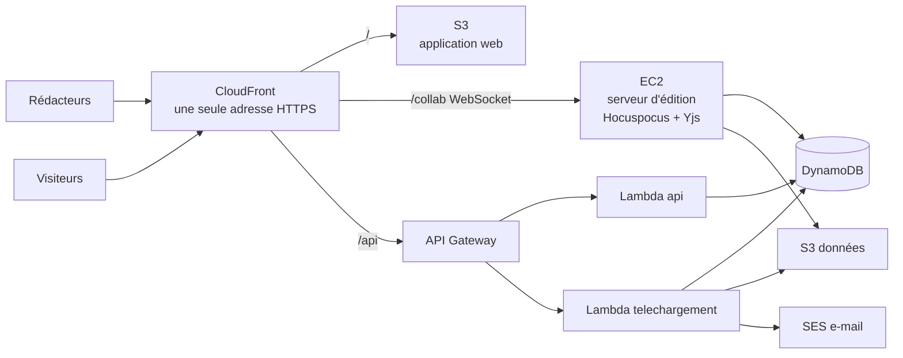

# B-SyncText

*Créez sans effort. Modifiez en temps réel. Synchronisez en un instant.*

B-SyncText est un éditeur de documents partagé : plusieurs personnes écrivent en même temps dans le même texte, et le document se diffuse en PDF par un lien au nombre de téléchargements limité. L'application est conçue pour un journal étudiant écrit par des centaines de rédacteurs et téléchargé par des milliers de lecteurs le jour de sa parution. Elle est déployée sur AWS.

## Fonctionnalités

- **Écriture à plusieurs en temps réel** : chacun voit qui est présent et où écrivent les autres.
- **Mise en forme de base** : titres, gras, italique, souligné, alignement, listes.
- **Historique des versions** et restauration.
- **Partage** par e-mail ou par lien d'invitation, avec des rôles (propriétaire principal, propriétaire, membre).
- **Lien de téléchargement PDF** limité à N exemplaires, qui donne toujours le document tel qu'il est au moment du clic. Chaque PDF est numéroté (« exemplaire 137 / 500 ») et porte son numéro de version.
- **Crédit d'écriture** de 10 000 caractères par rédacteur et par jour.
- **Blocage temporaire** des abus.
- **Tableau de bord** pour l'association : documents ouverts, liens actifs, personnes bloquées.
- **E-mail** au créateur d'un lien quand il est épuisé.

Il n'y a pas de compte : on entre avec un nom et un e-mail. Les visiteurs qui téléchargent ne donnent aucune identité.

## Architecture



**L'écriture et le téléchargement passent par deux chemins séparés** : le pic des visiteurs ne peut pas ralentir les rédacteurs.

| Contrainte | Comment elle est tenue |
|---|---|
| Exactement N téléchargements par lien | réservation par écriture conditionnelle atomique dans DynamoDB ; adresse de fichier à usage unique |
| Aucune modification perdue, même texte pour tous | CRDT **Yjs** ; une modification n'est confirmée qu'après son enregistrement dans DynamoDB |
| Le PDF reflète le document au moment du clic | le document est reconstruit au moment de la demande ; un PDF de base par état du document |
| Crédit journalier, même sur plusieurs appareils | décrément conditionnel d'un crédit par rédacteur et par jour |
| Pic de 15 000 visiteurs | Lambda à la demande ; une saturation devient « Patientez », jamais une erreur |
| Visiteurs informés de l'épuisement | état « épuisé » définitif, renvoyé sans lire le document |

## Technologies

| Partie | Choix |
|---|---|
| Application web | React, Vite, Tiptap (éditeur), TypeScript |
| Temps réel | Yjs (CRDT), Hocuspocus, Node.js 22 sur EC2 |
| API | Node.js 22 sur AWS Lambda, API Gateway HTTP |
| Données | DynamoDB, S3 |
| PDF | pdfmake, pdf-lib |
| Infrastructure | CloudFormation, AWS CLI |
| Tests | Vitest, scripts Node.js, k6 |

## Organisation du dépôt

```
src/
  web/              application web (React)
  edition/          serveur d'édition temps réel (EC2)
  api/              Lambda « api » : sessions, documents, membres, liens, tableau de bord
  telechargement/   Lambda « telechargement » : réservation des exemplaires, PDF, e-mail
  commun/           code partagé : crédit, jetons, versions, lecture du document Yjs
infra/              infrastructure (CloudFormation) et scripts de déploiement
tests/              tests de concurrence et de charge, générateur de charge
```

## Documentation du dépôt

| Fichier | Ce qu'il couvre |
|---|---|
| [infra/README.md](infra/README.md) | **description de l'infrastructure** : ressources AWS créées, droits de chaque composant, sécurité ; guide complet pour déployer, vérifier, supprimer ; coût |
| [API.md](API.md) | **description de l'API** : toutes les routes, corps et réponses, états du téléchargement, canal temps réel, et un exemple de test à écrire soi-même |
| [tests/README.md](tests/README.md) | **tests** : unitaires, de concurrence et de charge ; ce que vérifie chaque test (codes T-01 à T-07) ; commandes ; générateur de charge dans AWS |

## API

La description complète de l'API, assez précise pour écrire ses propres tests, est dans **[API.md](API.md)**.

## Déployer

Prérequis : un compte AWS, l'AWS CLI connectée (`aws login`, avec une région par défaut) et Node.js 22.
```
npm ci
infra/deployer.sh <votre-email>
```
Le script affiche l'adresse de l'application à la fin. Le détail (ressources créées, droits, vérification, coût) est dans **[infra/README.md](infra/README.md)**.

## Tester

```
npm test               # tests unitaires
npm run couverture     # avec la couverture
```
Les tests de concurrence et de charge, qui portent les codes T-01 à T-07, visent l'application déployée. Ils sont décrits dans **[tests/README.md](tests/README.md)**.

## Tableau de bord de l'association

Adresse : `https://<distribution>.cloudfront.net/association`. La page demande un **code administrateur**, créé au déploiement et rangé dans le coffre de paramètres d'AWS (jamais dans le dépôt). La personne qui a déployé le lit avec :
```
aws ssm get-parameter --name /bsynctext/code-admin --with-decryption --query Parameter.Value --output text
```
puis le transmet à l'association. Toute personne qui connaît ce code peut consulter le tableau de bord (lecture seule) ; dix codes faux en une minute bloquent les essais pendant une minute.

## Supprimer

```
infra/supprimer.sh
```
Cette commande supprime toutes les ressources AWS, après confirmation. Voir [infra/README.md](infra/README.md#5-supprimer).

## Auteur

Kengfack Tsafack Bernice Lagrange, 2026.
