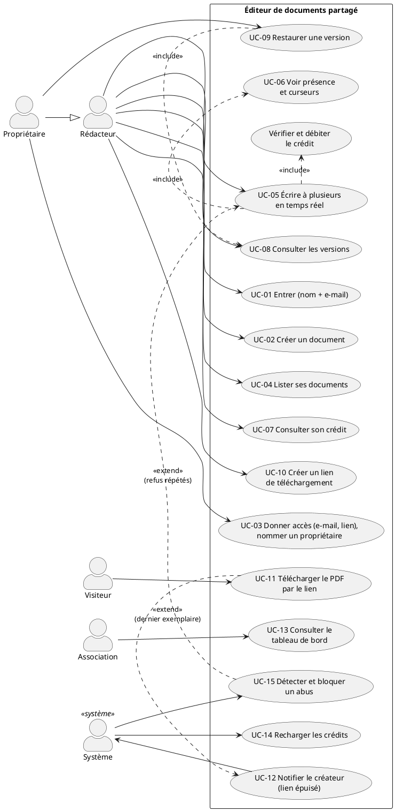

# 02 — Cas d'utilisation

> **Statut :** à valider · **Date :** 25/10/2026 · **Auteur :** Kengfack Tsafack Bernice Lagrange · **Alimente :** livrable 2 (dossier de conception), phase 5 (maquettes), phase 6 (scénarios de test)

Ce document décrit **qui fait quoi** avec l'application, et en déduit la **liste des écrans** (section 5) qui sert de base aux maquettes. Les échanges techniques entre composants (diagrammes de séquence) viendront en phase 4, une fois l'architecture choisie.

Identifiants : voir `01-besoins.md` (BF, C, H).

---

## 1. Diagramme

Source : [`uml/use-cases.puml`](uml/use-cases.puml) · image : [`uml/use-cases.png`](uml/use-cases.png).

En résumé :
- le **rédacteur** entre, crée et liste ses documents, écrit en temps réel, consulte son crédit, consulte et restaure les versions, crée des liens ;
- le **propriétaire** est un rédacteur qui peut en plus donner accès au document et nommer d'autres propriétaires ;
- le **visiteur** télécharge par le lien ;
- l'**association** consulte le tableau de bord ;
- le **système** recharge les crédits, bloque les abus et envoie les e-mails.

---

## 2. Vue d'ensemble

| UC | Nom | Acteur | BF | Contraintes | Écrans | Prio |
|---|---|---|---|---|---|---|
| UC-01 | Entrer | Rédacteur | BF-01 | — | E-01 | E |
| UC-02 | Créer un document | Rédacteur | BF-02 | — | E-02 | E |
| UC-03 | Donner accès à un document, nommer un propriétaire | Propriétaire | BF-03, BF-21, BF-23 | — | E-04 | E |
| UC-04 | Lister ses documents | Rédacteur | BF-04 | — | E-02 | E |
| UC-05 | Écrire à plusieurs en temps réel | Rédacteur | BF-05, BF-14 | **C-2**, C-4 | E-03 | E |
| UC-06 | Voir la présence et les curseurs | Rédacteur | BF-06 | — | E-03 | I |
| UC-07 | Consulter son crédit | Rédacteur | BF-15 | C-4 | E-02, E-03 | I |
| UC-08 | Consulter les versions | Rédacteur | BF-07 | — | E-05 | I |
| UC-09 | Restaurer une version | Propriétaire | BF-08 | C-2 | E-05 | I |
| UC-10 | Créer un lien de téléchargement | Rédacteur | BF-09, BF-19 | C-1 | E-06 | E |
| UC-11 | Télécharger le PDF par le lien | Visiteur | BF-10 à BF-13, BF-20 | **C-1**, C-3, C-5, C-6 | E-07 | E |
| UC-12 | Notifier le créateur d'un lien épuisé | Système | BF-18 | — | E-11 | E |
| UC-13 | Consulter le tableau de bord | Association | BF-17 | — | E-08, E-09 | E |
| UC-14 | Recharger les crédits | Système | BF-14 | C-4 | — | E |
| UC-15 | Détecter et bloquer un abus | Système | BF-16 | — | E-10 | E |

---

## 3. Fiches

### UC-01 — Entrer
- **Acteur :** rédacteur.
- **Scénario :** 1. Il saisit son nom et son e-mail ; le bouton « Entrer » reste inactif tant que l'e-mail n'a pas un format valide. 2. L'application cherche la fiche rédacteur de cet e-mail, la crée si c'est la première visite (H-01), et ouvre une session. 3. Elle affiche les documents liés à cet e-mail (UC-04) : ceux qu'il a créés et ceux auxquels on lui a donné accès, même avant sa première visite.
- **Alternatives :** e-mail mal formé → impossible de valider, message sous le champ ; le serveur refuse aussi un e-mail mal formé, au cas où. Rédacteur bloqué → il entre, mais voit l'état de blocage et l'heure de fin (E-10).
- **Règle :** aucune vérification de l'e-mail ni mot de passe (sujet). La session évite de redemander l'identité à chaque action. Les rédacteurs sont des utilisateurs de l'application, pas des utilisateurs AWS : ils n'ont aucun accès au compte AWS.

### UC-02 — Créer un document
- **Acteur :** rédacteur, qui en devient propriétaire principal.
- **Scénario :** 1. Il donne un titre. 2. Le document vide est créé. 3. L'éditeur s'ouvre (UC-05).
- **Règle :** le titre ne consomme pas de crédit.

### UC-03 — Donner accès à un document, nommer un propriétaire
- **Acteur :** propriétaire (H-05).
- **Scénario :** 1. Il saisit l'e-mail d'un autre rédacteur. 2. Le document apparaît dans la liste de ce rédacteur. 3. La liste des membres s'affiche, avec le rôle de chacun.
- **Variante, lien d'invitation (BF-23) :** il copie le lien d'invitation du document et le diffuse (pratique pour inviter 250 personnes). Qui l'ouvre saisit nom et e-mail (E-01), puis arrive dans l'éditeur comme membre. « Régénérer le lien » invalide l'ancien.
- **Variante, nommer un propriétaire (BF-21) :** dans la liste des membres, il choisit un membre et le nomme propriétaire. Ce membre peut désormais donner accès et nommer à son tour.
- **Variante, renoncer :** un propriétaire peut redevenir simple membre, **seulement s'il reste au moins un autre propriétaire**. Si c'est le principal qui renonce, le propriétaire nommé le plus anciennement devient principal.
- **Variante, retirer un propriétaire :** seul le principal peut rendre un autre propriétaire simple membre.
- **Alternatives :** e-mail déjà membre → rien ne change ; e-mail mal formé → impossible de valider ; lien d'invitation régénéré → l'ancien affiche « invitation expirée ».
- **Règle :** l'invité n'a pas besoin d'être déjà venu dans l'application. Aucun e-mail d'invitation n'est envoyé.

### UC-04 — Lister ses documents
- **Acteur :** rédacteur.
- **Scénario :** il voit les documents dont il est propriétaire ou membre, avec le titre, le propriétaire principal, la date de dernière modification et le nombre de personnes connectées.

### UC-05 — Écrire à plusieurs en temps réel
- **Acteur :** rédacteur membre du document.
- **Préconditions :** session ouverte, rédacteur non bloqué.
- **Scénario :**
  1. Il ouvre le document : il reçoit le contenu à jour et la liste des présents (UC-06).
  2. Il écrit. Chaque insertion est vérifiée et débitée sur son crédit (H-02).
  3. Le serveur accepte la modification et l'enregistre ; l'indicateur passe de « Synchronisation… » à « Enregistré ». **Une modification est acceptée quand le serveur l'a enregistrée**, pas avant.
  4. Sa modification apparaît chez les autres presque aussitôt (BNF-03), et la leur chez lui.
  5. Si deux rédacteurs écrivent au même endroit au même instant, les deux modifications sont gardées et tous finissent avec le même texte (**C-2**).
- **Alternatives :**
  - **Crédit insuffisant** : l'insertion est refusée en entier (H-04), avec le crédit restant et l'heure de recharge. La suppression reste possible, sans rendre de crédit (H-02).
  - **Plusieurs appareils** : le crédit est commun à toutes les sessions du rédacteur ; le total accepté ne dépasse jamais 10 000 par jour (**C-4**).
  - **Connexion perdue** : un bandeau le signale aussitôt (« Hors ligne — vos modifications seront envoyées au retour de la connexion ») ; les modifications faites hors ligne sont envoyées au retour, puis vérifiées comme les autres (crédit compris). Tant qu'elles ne sont pas enregistrées, elles ne sont pas « acceptées ». Une modification refusée est retirée de son écran, avec un message.
  - **Refus répétés** : peuvent déclencher un blocage (UC-15).
- **Postcondition :** toute modification **acceptée** est enregistrée durablement et présente chez tous les participants.

### UC-06 — Voir la présence et les curseurs
- **Acteur :** rédacteur.
- **Scénario :** il voit la liste des personnes connectées au document (nom, couleur) et, dans le texte, la position du curseur de chacune.
- **Règle :** la présence n'est pas une modification du document : elle ne consomme pas de crédit et n'entre pas dans les versions.

### UC-07 — Consulter son crédit
- **Acteur :** rédacteur.
- **Scénario :** le crédit restant du jour et l'heure de la prochaine recharge sont affichés en permanence (liste et éditeur), et mis à jour pendant la frappe.

### UC-08 — Consulter les versions
- **Acteur :** rédacteur membre.
- **Scénario :** 1. Il ouvre l'historique. 2. Il voit les versions (date, heure, auteurs de la période). 3. Il en sélectionne une et lit son contenu, sans modifier le document.
- **Variante :** il crée une version à la main, avec un nom.
- **Règle :** sinon, les versions sont prises automatiquement, toutes les 10 minutes d'activité au plus (H-06).

### UC-09 — Restaurer une version
- **Acteur :** propriétaire (H-06).
- **Scénario :** 1. Depuis une version (UC-08), il demande la restauration et confirme. 2. Le contenu du document redevient celui de la version, pour tous les participants connectés, en direct. 3. Une nouvelle version « restauration de la version du … » apparaît dans l'historique.
- **Alternatives :** des rédacteurs écrivent pendant la restauration → leurs modifications sont traitées comme des modifications concurrentes ordinaires (C-2).
- **Règles :** l'historique n'est jamais réécrit ni raccourci ; la restauration ne consomme pas de crédit (H-02).

### UC-10 — Créer un lien de téléchargement
- **Acteur :** rédacteur membre.
- **Scénario :** 1. Il choisit le nombre de téléchargements autorisés N (H-11). 2. L'application crée le lien et affiche son adresse, à copier. 3. Le lien apparaît dans la liste de ses liens avec les téléchargements restants (BF-19).
- **Règles :** le lien ne fige pas le contenu : il donnera toujours le document au moment du téléchargement (C-3). Plusieurs liens peuvent exister pour un même document, chacun avec son propre compteur.

### UC-11 — Télécharger le PDF par le lien
- **Acteur :** visiteur, sans identité.
- **Scénario nominal :**
  1. Il ouvre le lien : une page s'affiche (E-07) et demande aussitôt un exemplaire.
  2. Il reçoit immédiatement un **état** (BF-13) :
     - **« Votre exemplaire est prêt »** : un exemplaire lui est réservé 60 s (n° k / N), avec une adresse de fichier à usage unique (H-07) ; le téléchargement démarre seul ;
     - **« Patientez »** : les exemplaires restants sont tous réservés par d'autres, ou le service est saturé ; la page réessaie seule, sans qu'il ait à recliquer ;
     - **« Épuisé »** : tous les exemplaires sont distribués.
  3. Le navigateur demande le fichier avec l'adresse à usage unique : l'exemplaire est alors **compté**, et le visiteur reçoit un PDF du document **tel qu'il est à cet instant**, complet et cohérent (C-3, H-08).
- **Alternatives :**
  - **Téléchargement automatique bloqué par le navigateur** : un bouton « Télécharger » utilise la même adresse, tant qu'elle n'a pas servi.
  - **Onglet fermé avant la demande du fichier** : la réservation expire au bout de 60 s et l'exemplaire revient dans le stock (H-07).
  - **Téléchargement interrompu** : l'adresse est déjà consommée. En recliquant sur le lien public, il obtient un nouvel exemplaire s'il en reste.
  - **Lien inconnu** : message « lien introuvable ».
  - **Épuisement pendant l'attente** : la page passe d'elle-même à « Épuisé » en quelques secondes (**C-6**, BNF-07).
  - **Dernier exemplaire compté** : déclenche UC-12.
- **Règles :**
  - jamais plus de N exemplaires comptés, quel que soit le nombre de clics simultanés ; compté + réservé ≤ N à tout instant (**C-1**) ;
  - une adresse de fichier ne sert qu'une fois (R-02) ;
  - un visiteur n'est jamais ignoré, même au pic : une saturation devient « Patientez », jamais une erreur (**C-5**) ;
  - un lien épuisé est désactivé : la réponse « Épuisé » ne lit pas le document et ne génère pas de PDF (C-6, BF-12) ;
  - un visiteur n'est jamais bloqué par adresse IP pendant le pic (H-10, R-07).

### UC-12 — Notifier le créateur d'un lien épuisé
- **Acteur :** système.
- **Déclencheur :** le dernier exemplaire d'un lien est compté.
- **Scénario :** un e-mail part vers le créateur du lien : document, nombre d'exemplaires, date et heure de l'épuisement.
- **Règle :** **exactement un** e-mail par lien, même si l'événement est traité deux fois (BNF-10).

### UC-13 — Consulter le tableau de bord
- **Acteur :** association.
- **Scénario :** 1. Elle saisit le code administrateur (H-09). 2. Elle voit trois sections, rafraîchies automatiquement (BNF-09) :
  - **documents ouverts** (H-13) : titre, nombre de personnes connectées ;
  - **liens actifs** : document, créateur, N, téléchargements restants ;
  - **personnes bloquées** : nom, e-mail, motif, heure de fin du blocage.
- **Alternative :** code faux → refus ; tentatives répétées → limitées.
- **Règle :** lecture seule.

### UC-14 — Recharger les crédits
- **Acteur :** système.
- **Scénario :** à l'heure de recharge (H-03), chaque rédacteur retrouve 10 000 caractères. Le crédit non utilisé ne se cumule pas.

### UC-15 — Détecter et bloquer un abus
- **Acteur :** système.
- **Déclencheur :** un rédacteur dépasse le seuil de tentatives refusées (H-10).
- **Scénario :** 1. Il est bloqué pour une durée définie. 2. Il voit l'état de blocage et l'heure de fin (E-10) ; ses écritures sont refusées. 3. Il apparaît sur le tableau de bord. 4. À l'échéance, le blocage est levé automatiquement.

---

## 4. Parcours

Les trois parcours qui comptent pour le jury et pour les tests.

**Parcours A — Écrire le journal à plusieurs.** Camille entre (UC-01), crée « Journal 2026 » (UC-02) et envoie le lien d'invitation à Idriss et Sarah (UC-03). Tous trois ouvrent le document (UC-05), se voient (UC-06) et écrivent, parfois dans le même paragraphe. Idriss colle un long texte avec peu de crédit restant : le collage est refusé, il voit l'heure de recharge (UC-07). Sarah supprime un passage par erreur ; Camille, propriétaire, consulte l'historique et restaure la version précédente (UC-08, UC-09).
→ teste C-2, C-4.

**Parcours B — La parution.** Camille crée un lien de 500 exemplaires (UC-10) et l'association l'annonce pour 18h. À 18h, 15 000 personnes cliquent, dont 12 000 dans la première minute (UC-11). Les premiers servis obtiennent chacun un exemplaire numéroté ; quand tous les exemplaires restants sont réservés, les suivants patientent ; quelques réservations non utilisées reviennent dans le stock et profitent à ceux qui patientaient ; une fois les 500 comptés, tous les autres voient « Épuisé ». Camille reçoit un e-mail (UC-12). Pendant ce temps, l'équipe corrige une coquille : les exemplaires distribués après la correction la contiennent (C-3), et les 300 rédacteurs continuent d'écrire.
→ teste C-1, C-3, C-5, C-6.

**Parcours C — L'association surveille.** Pendant la parution, l'association suit le tableau de bord (UC-13) : documents ouverts, lien avec ses exemplaires restants qui descendent, et un rédacteur bloqué pour avoir insisté sans crédit (UC-15).
→ teste BF-16, BF-17.

---

## 5. Écrans

Liste déduite des cas d'utilisation. C'est **l'entrée des maquettes** (phase 5). Pour chaque écran : son contenu et ses états à dessiner.

| ID | Écran | Contenu | États à dessiner | UC |
|---|---|---|---|---|
| E-01 | Entrée | nom de l'application, champs nom et e-mail, bouton « Entrer » (inactif tant que l'e-mail est invalide) ; si on arrive par un lien d'invitation : « Vous êtes invité à écrire dans … » | normal ; e-mail invalide ; arrivée par invitation ; invitation expirée | UC-01, UC-03 |
| E-02 | Mes documents | en-tête (nom du rédacteur, crédit restant, heure de recharge) ; bouton « Nouveau document » ; liste (titre, propriétaire principal, dernière modification, personnes connectées) | liste vide ; liste remplie | UC-02, UC-04, UC-07 |
| E-03 | Éditeur | titre ; barre de mise en forme (titres, gras, italique, souligné, alignement, listes) ; zone de texte ; présents (pastilles nom et couleur) ; curseurs colorés des autres dans le texte ; crédit restant ; indicateur d'enregistrement (« Enregistré », « Synchronisation… », « Hors ligne ») ; boutons « Partager » (propriétaire), « Liens » ; **historique en colonne de gauche** (sur ordinateur) | normal à plusieurs ; crédit faible ; insertion refusée (crédit) ; hors ligne ; rédacteur bloqué | UC-05, UC-06, UC-07 |
| E-04 | Partager (fenêtre) | champ e-mail, bouton « Donner accès » ; lien d'invitation avec « Copier » et « Régénérer » ; liste des membres avec leur rôle (principal, propriétaire, membre) ; actions « Nommer propriétaire », « Retirer le rôle » (principal seulement), « Renoncer à mon rôle » | normal ; e-mail invalide ; dernier propriétaire (renoncement impossible) ; lien régénéré | UC-03 |
| E-05 | Historique (variante téléphone de la colonne de E-03) | liste des versions (date, heure, nom éventuel, auteurs) ; numéro (v1, v2, v3.1…) ; bouton « Créer une version » ; aperçu en lecture seule ; bouton « Restaurer » (propriétaires) avec confirmation | liste ; aperçu ; confirmation | UC-08, UC-09 |
| E-06 | Liens de téléchargement (fenêtre) | choix de N, bouton « Créer », adresse à copier ; liste des liens du document avec restants / N | création ; lien créé ; lien épuisé | UC-10 |
| E-07 | Page publique de téléchargement | nom de l'application et du document ; **un grand état clair** ; aucune identité demandée | **« Votre exemplaire est prêt » (n° k / N)**, avec bouton « Télécharger » de secours ; **« Patientez »** (mise à jour automatique) ; **« Épuisé »** ; « Lien introuvable » | UC-11 |
| E-08 | Accès association | champ code administrateur | normal ; code faux | UC-13 |
| E-09 | Tableau de bord | trois blocs : documents ouverts ; liens actifs (restants / N, barre de progression) ; personnes bloquées (motif, fin) ; heure de dernière mise à jour | normal ; blocs vides | UC-13 |
| E-10 | Messages transverses | bandeaux ou écrans : crédit épuisé (heure de recharge) ; rédacteur bloqué (heure de fin) ; connexion perdue | — | UC-05, UC-15 |
| E-11 | E-mail « lien épuisé » | objet, document, N, date et heure, nom de l'application | — | UC-12 |
| ~~E-12~~ | ~~E-mail « invitation »~~ — retiré le 25/10 (BF-22 retiré) | — | — | — |

**Priorités pour les maquettes**, si le temps manque : E-03 (éditeur) et E-07 (page publique) d'abord, car ce sont les écrans des deux contraintes éliminatoires et du pic. Puis E-01, E-02, E-09, E-06. Les autres peuvent rester simples.
