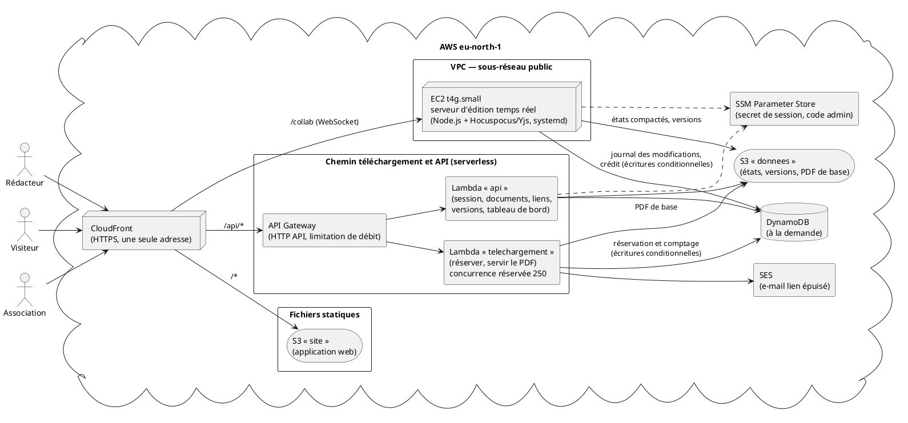

# 03 — Architecture

> **Statut :** à valider · **Date :** 25/10/2026 · **Auteur :** Kengfack Tsafack Bernice Lagrange · **Alimente :** livrable 2, oral

## 1. Vue d'ensemble

**Idée directrice : deux chemins séparés.** L'écriture (300 rédacteurs, temps réel) passe par un petit serveur EC2. Le téléchargement (15 000 visiteurs) passe par des fonctions Lambda. Le pic des visiteurs ne peut donc pas ralentir les rédacteurs (C-5).

| Composant | Rôle | Pourquoi lui |
|---|---|---|
| CloudFront | une seule adresse HTTPS pour tout ; aiguille `/*`, `/api/*`, `/collab` | certificat HTTPS sans nom de domaine ; même origine, donc pas de CORS ; gratuit à notre volume |
| S3 « site » | pages de l'application (privé, lu par CloudFront seulement) | fichiers statiques, coût nul |
| EC2 t4g.small | serveur d'édition temps réel (WebSocket) | une connexion longue par rédacteur ; garde les documents ouverts en mémoire |
| API Gateway + Lambda « api » | session, documents, membres, liens, versions, tableau de bord | requêtes courtes ; ne coûte rien au repos |
| Lambda « telechargement » | réserver un exemplaire, servir le PDF | absorbe le pic automatiquement ; 250 exécutions simultanées lui sont réservées |
| DynamoDB (à la demande) | toutes les données ; écritures **conditionnelles** pour C-1 et C-4 | opérations atomiques natives ; paiement à la requête |
| S3 « donnees » | états compactés des documents, versions, PDF de base (CH-06) | objets de taille libre, peu coûteux |
| SES | e-mail « lien épuisé » | service d'e-mail d'AWS, disponible en eu-north-1 |
| SSM Parameter Store | secret de signature des sessions, code administrateur | secrets hors du dépôt, gratuits |

## 2. Comment chaque contrainte est tenue

| Contrainte | Mécanisme |
|---|---|
| **C-1** | Le lien a un compteur `disponibles`. Pour réserver, on le décrémente par une **écriture conditionnelle** (`disponibles > 0`), que DynamoDB exécute de façon atomique : 1 000 demandes simultanées ne peuvent pas obtenir plus de N réservations. L'adresse du fichier est **à usage unique** : elle est consommée par une autre écriture conditionnelle (`statut = réservé`). Invariant : comptés + réservés + disponibles = N. |
| **C-2** | **CRDT Yjs** (D-004) : chaque modification a un identifiant unique ; les fusions donnent le même texte quel que soit l'ordre d'arrivée. Une modification est **acceptée** quand elle est écrite dans le journal DynamoDB ; c'est seulement ensuite que le serveur la diffuse et la confirme. Si l'EC2 redémarre, l'état est reconstruit à partir de S3 et du journal, et les navigateurs renvoient d'eux-mêmes ce qui n'était pas confirmé. |
| C-3 | Le PDF est construit à partir du dernier état S3 et du journal, lu en lecture forte au moment de la demande du fichier. Il contient donc toute modification acceptée avant. Un PDF de base est gardé **par état du document** et réutilisé tant que le texte ne change pas. |
| C-4 | Crédit du jour = un élément DynamoDB par rédacteur et par jour, décrémenté par une écriture conditionnelle (`restant >= n`). Ce crédit est unique, quel que soit l'appareil. Une insertion trop longue est refusée en entier (H-04). |
| C-5 | Les visiteurs ne touchent pas l'EC2. Au-delà de la capacité (limite d'API Gateway, quota Lambda, débit DynamoDB), la réponse 429 devient « Patientez » et la page réessaie toutes les 2 s : aucun visiteur sans réponse. |
| C-6 | Quand le dernier exemplaire est compté, le lien passe à `épuisé`. Cet état est définitif : chaque fonction le garde en mémoire, et toute demande répond « Épuisé » sans lire le document. L'e-mail part une seule fois, grâce à un drapeau posé par écriture conditionnelle. |

**Pas de tâche planifiée.** La recharge du crédit est implicite : l'élément de crédit est créé à 10 000 au premier usage de la journée WAT. De même, un blocage porte son heure de fin, et il suffit de la comparer à l'heure courante. La remise en stock des réservations expirées est faite par les visiteurs qui patientent, au moment où ils redemandent. Il n'y a donc aucun service de plus à payer ni à surveiller.

## 3. Dimensionnement du pic

Source : AWS, *Understanding Lambda function scaling* (docs.aws.amazon.com/lambda/latest/dg/lambda-concurrency.html).
- Simultanéité = requêtes/s × durée moyenne (s).
- Débit maximal = 10 × quota, soit 4 000 req/s pour notre quota de 400.
- Une fonction peut gagner 1 000 environnements toutes les 10 s.

**Charge** : 12 000 clics en 60 s, soit 200/s en moyenne. On dimensionne sur une **pointe de 1 000/s**, 5 fois la moyenne.

| Requête Lambda | Débit | Durée estimée | Simultanéité |
|---|---|---|---|
| Réservation | 1 000/s | 0,1 s | 100 |
| Envoi du PDF (N = 500) | 100/s | 0,3 s | 30 |
| Relances des visiteurs qui patientent | 1 000/s | 0,05 s | 50 |
| **Total** | **2 100/s** | | **180** |

Ce total de 180 tient dans les 250 réservés à « telechargement » : il reste une marge de ×1,4, et ×2,2 par rapport au quota du compte. Le débit de 2 100 req/s tient dans la limite de 4 000. Les rédacteurs ne consomment pas de quota Lambda : ils passent par l'EC2. Le test de charge (phase 9) remplacera ces estimations par des mesures.

**Rédacteurs (H-14)** : 300 rédacteurs à environ 2 modifications/s font 600 écritures/s dans le journal. C'est peu pour DynamoDB à la demande, et à la portée d'un seul processus Node.js. Si la mesure montre le contraire, on passe l'EC2 à une taille supérieure, ce qui ne demande qu'une ligne d'infrastructure.

## 4. Coût estimé (du 25 au 27/10)

| Poste | Estimation |
|---|---|
| EC2 t4g.small + adresse IPv4 publique, environ 72 h | ≈ 1,6 USD |
| Lambda, API Gateway, DynamoDB, S3, CloudFront, en grande partie dans les offres gratuites, tests de charge compris | ≈ 1 à 3 USD |
| **Total visé** | **< 5 USD**, mesuré en phase 10 |

## 5. Limites assumées

- **Un seul serveur d'édition.** S'il tombe, l'édition s'interrompt le temps du redémarrage : systemd relance le processus, et AWS relance l'instance en cas de panne matérielle. **Aucune modification acceptée n'est perdue**, puisque les données sont dans DynamoDB et S3. Passer à plusieurs serveurs demanderait une diffusion partagée entre eux (Redis), ce qui est inutile pour 300 rédacteurs.
- Le trafic entre CloudFront et l'EC2 est en HTTP. Le groupe de sécurité n'accepte que les adresses de CloudFront (liste gérée par AWS), et CloudFront ajoute un en-tête secret que le serveur vérifie.
