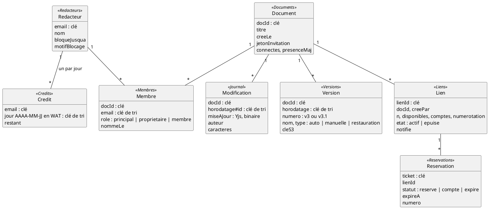
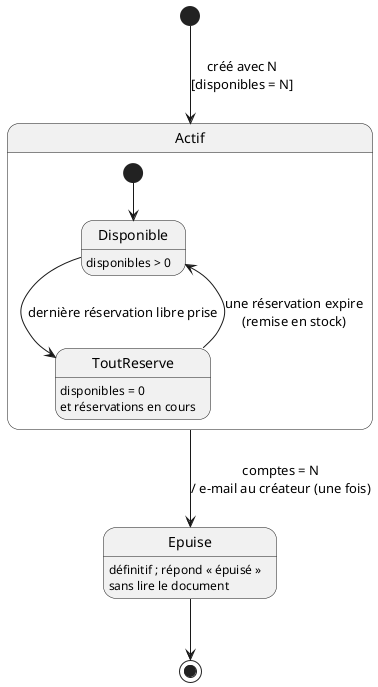
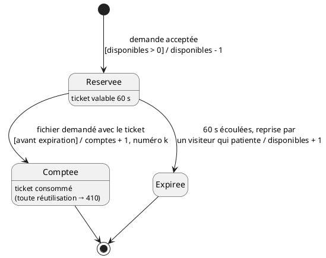
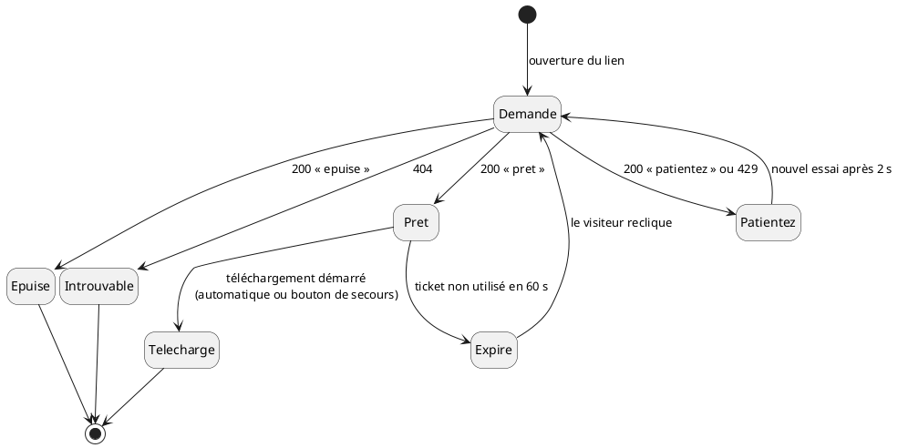
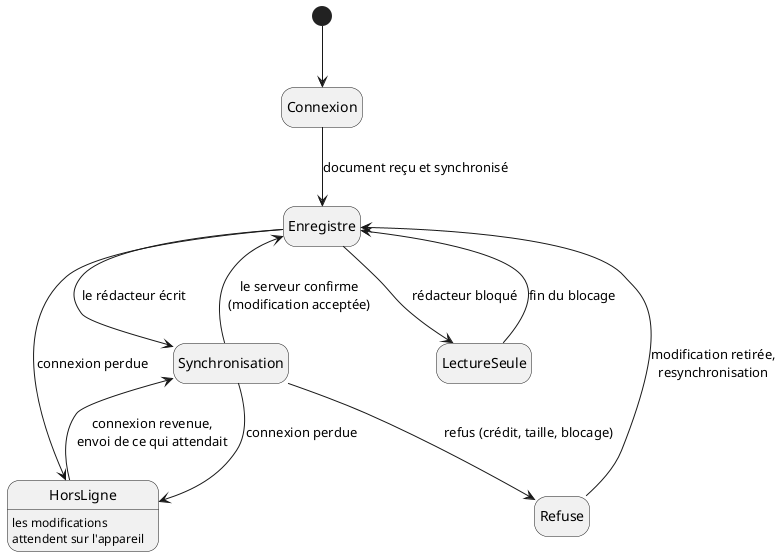
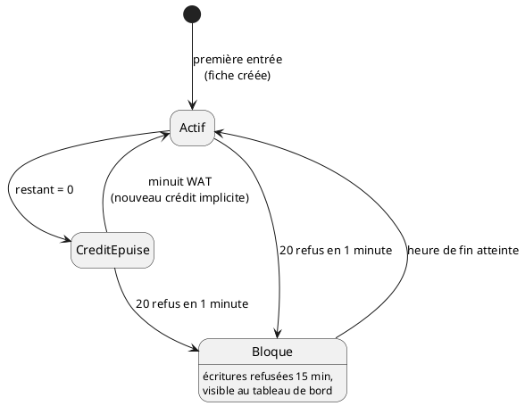
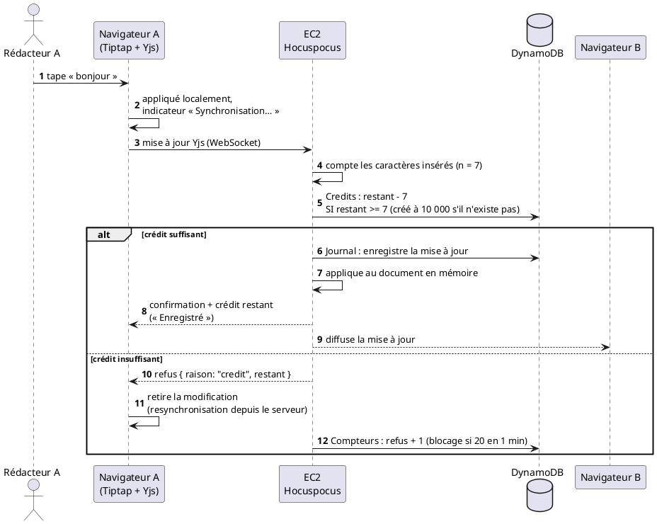
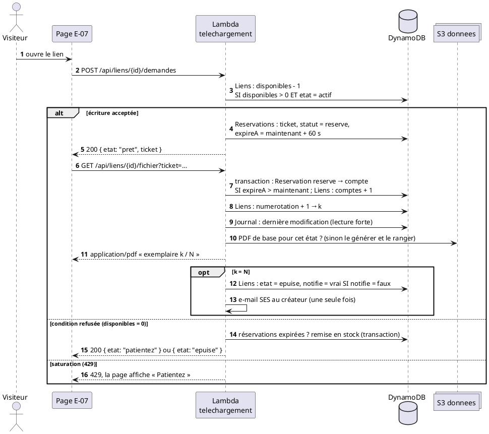

# 06 — Données et API

> **Statut :** à valider · **Date :** 25/10/2026 · **Auteur :** Kengfack Tsafack Bernice Lagrange · **Alimente :** livrable 2, **livrable 4 (description de l'API)**

## 1. Données

- **Une table DynamoDB par entité.** C'est plus simple à expliquer qu'une table unique, et le coût est le même à la demande.
- **Index secondaires** :
  - `Membres` par `email`, pour lister les documents d'un rédacteur ;
  - `Liens` par `docId` ;
  - `Reservations` par `lienId`, uniquement pour les réservations au statut `reserve`.
- **Durées de vie automatiques (TTL)** :
  - `Credits` : 2 jours ;
  - `Compteurs` (refus, essais du code administrateur) : 10 minutes ;
  - `Journal` : 7 jours, en plus du nettoyage après compactage.
- **S3 « donnees »** contient trois dossiers :
  - `etats/{docId}.bin` : dernier état compacté du document ;
  - `versions/{docId}/{horodatage}.bin` : les versions ;
  - `pdf/{docId}/{idModification}.pdf` : un PDF de base par état du document.

**Écritures atomiques qui portent les contraintes**

| But | Écriture DynamoDB |
|---|---|
| Débiter le crédit, avec recharge implicite (C-4) | `SET restant = if_not_exists(restant, 10000) - :n` SI `attribute_not_exists(restant) OR restant >= :n` |
| Réserver un exemplaire (C-1) | `SET disponibles = disponibles - 1` SI `disponibles > 0 AND etat = actif` |
| Compter un exemplaire (C-1, R-02) | réservation `reserve → compte` SI `expireA > maintenant`, puis `ADD numerotation 1, comptes 1` sur le lien (donne k) |
| Remettre en stock une réservation expirée | réservation `reserve → expire` SI `expireA <= maintenant`, puis `disponibles + 1` sur le lien |
| Un seul e-mail (BNF-10) | `SET notifie = true` SI `notifie = false` |

**Numéros de version.** Un compteur atomique sur le document (`ADD numeroVersion 1`) donne :
- un **entier** pour une version manuelle ou une restauration : v1, v2, v3… ;
- un **décimal** pour une version automatique : v3.1, v3.2… après v3.

**Le PDF inscrit toujours un numéro de version.** Si l'état téléchargé ne correspond à aucune version existante, la Lambda en crée une automatique au moment où elle génère le PDF de base. Il y en a au plus une par état du document, puisque le PDF de base est réutilisé tant que le texte ne change pas.

**Pas de transaction sur la fiche du lien.** Au pic, des centaines d'écritures la visent en même temps, et DynamoDB annule les transactions en conflit. Le premier essai de T-01 l'a montré : des exemplaires étaient comptés sans être livrés. Chaque étape est donc une écriture conditionnelle simple, réessayée en cas de saturation.

**Invariant du lien** : `disponibles + réservations actives + comptes = N`.

**En cas de panne entre deux écritures** (par exemple, une Lambda interrompue juste après avoir réservé), le pire cas est **un exemplaire perdu, jamais un exemplaire de trop**. Ce choix est voulu et documenté.

## 2. États

**Lien et réservation** (C-1, C-6) : un lien épuisé ne revient jamais à l'état actif. Une réservation est comptée une seule fois, ou bien elle expire et son exemplaire revient dans le stock.

 

**Page de téléchargement** (C-5, C-6) : chaque visiteur est toujours dans un état nommé, jamais sans réponse.

**Éditeur et rédacteur** (C-2, C-4) : « Enregistré » ne s'affiche qu'après acceptation par le serveur.

 

## 3. API REST

- **Base** : `https://<distribution>.cloudfront.net/api`. Le format est JSON, sauf pour le PDF.
- **Authentification** : `Authorization: Bearer <jeton>`, avec le jeton obtenu par `POST /session`. Les routes marquées 🌐 sont publiques.
- **Erreurs** : `{ "erreur": { "code": "…", "message": "…" } }`.
  - 400 : requête invalide ;
  - 401 : pas de jeton ;
  - 403 : droit manquant ;
  - 404 : introuvable ;
  - 409 : conflit ;
  - 410 : expiré ou déjà utilisé ;
  - 423 : rédacteur bloqué ;
  - 429 : trop de requêtes.

| Méthode et chemin | Corps → Réponse | Règles |
|---|---|---|
| 🌐 `POST /session` | `{nom, email}` → `{jeton, redacteur:{email, nom, credit:{restant, rechargeA}, bloqueJusqua}}` | e-mail validé ; crée la fiche si besoin |
| `GET /moi` | → même objet `redacteur` | |
| `GET /documents` | → `[{docId, titre, role, principal, modifieLe, connectes}]` | documents dont on est membre |
| `POST /documents` | `{titre}` → `{docId, …}` | le créateur devient principal |
| `GET /documents/{docId}` | → `{docId, titre, role, membres:[{email, nom, role}], lienInvitation}` | membre ; `lienInvitation` seulement pour un propriétaire |
| `PATCH /documents/{docId}` | `{titre}` → `{docId, titre}` | membre ; 1 à 120 caractères |
| `POST /documents/{docId}/membres` | `{email}` → `201` | propriétaire |
| `PATCH /documents/{docId}/membres/{email}` | `{role: "proprietaire" \| "membre"}` → `200` | propriétaire. Retirer le rôle à un autre : principal seulement. Renoncer : 409 si on est le dernier propriétaire |
| `POST /documents/{docId}/invitation` | → `{lienInvitation}` | propriétaire ; régénère, l'ancien lien renvoie 410 |
| `POST /invitations/{jeton}` | → `{docId}` | rédacteur connecté ; devient membre |
| `GET /documents/{docId}/versions` | → `[{versionId, horodatage, nom, type, auteurs}]` | membre |
| `GET /documents/{docId}/versions/{versionId}` | → `{contenu}` (lecture seule) | membre |
| `POST /documents/{docId}/liens` | `{n}` → `{lienId, url, n}` | membre ; 1 ≤ n ≤ 10 000 |
| `GET /documents/{docId}/liens` | → `[{lienId, n, restants, etat}]` | membre |
| 🌐 `GET /liens/{lienId}` | → `{titre, n, restants, etat}` | |
| 🌐 `POST /liens/{lienId}/demandes` | → voir ci-dessous | jamais d'identité demandée |
| 🌐 `GET /liens/{lienId}/fichier?ticket=…` | → `application/pdf`, en pièce jointe | 410 si le ticket est déjà utilisé ou a expiré |
| `GET /admin/tableau-de-bord` | en-tête `X-Code-Admin` → `{documentsOuverts, liensActifs, bloques}` | 10 échecs par minute au plus |

**Réponses de `POST /liens/{lienId}/demandes`** (la salle d'attente, D-006) :
- `200 {"etat":"pret", "ticket":"…", "expireA":"…"}` : télécharger avec `/fichier` avant `expireA` (60 s).
- `200 {"etat":"patientez", "reessayerDans":2}` : tous les exemplaires restants sont réservés par d'autres.
- `200 {"etat":"epuise"}` : définitif.
- `429` : saturation, à traiter comme « patientez ».
- `404` : lien inconnu.

**Pour écrire un test de C-1** : envoyer M demandes simultanées sur un lien de N exemplaires, puis appeler `/fichier` pour chaque ticket obtenu. On doit obtenir exactement N PDF, numérotés de 1 à N, et toutes les demandes suivantes doivent recevoir `epuise`.

## 4. Temps réel (WebSocket)

- **Adresse** : `wss://<distribution>.cloudfront.net/collab`. Protocole **Hocuspocus/Yjs** : nom du document = `docId`, jeton de session dans le champ `token`.
- **Messages du serveur** :
  - `{type:"credit", restant}` après chaque modification acceptée ;
  - `{type:"refus", raison:"credit"|"taille"|"bloque", restant?, bloqueJusqua?}`.
- **Messages du client** :
  - `{type:"creerVersion", nom}` : membre ;
  - `{type:"restaurer", versionId}` : propriétaire.

Le déroulé d'une modification acceptée est dans le diagramme ci-dessous.

